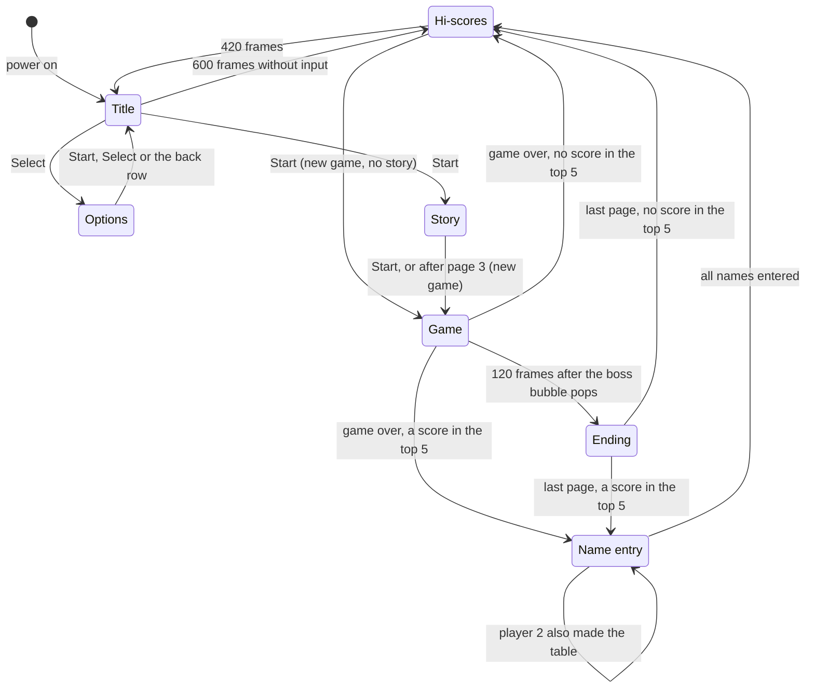
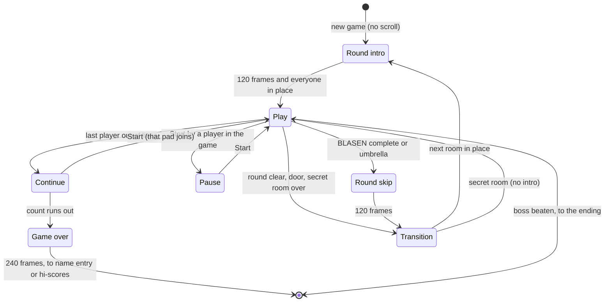

# Blubber Blasen: the spec

Status: draft 1, 2026-11-22, written from the code of version 1.4.0 (`src/game`). Where this spec
and the design guide disagree, this spec describes what the game does today; each case is listed
in [decisions.md](decisions.md) for the user to rule on.

Units: a frame is 1/60 s. A pixel is one screen pixel. Positions are the top-left corner of a
sprite. "Speed 1.5" means 1.5 pixels per frame. Fractions are exact (8.8 fixed point in the
code): 0.918 stands for 235/256. All random choices come from one generator (section 13).

## 1. The world

- The screen is 256 x 224. The top 16 pixels are the HUD. The room below it is 32 x 26 tiles of
  8 x 8 pixels (y 16 to 223). Nothing scrolls during play.
- Sprites are 16 x 16. The boss is 32 x 32.
- A tile is solid or open. It also holds an air direction: none, up, down, left, right.
- Platforms are one-way: players, enemies and thrown things rise through them and land on top.
  The side walls (tile columns 0, 1, 30, 31) are always solid. The top border row of the room is
  not ground except at the side walls. Beyond the room, up and down are open; left and right are
  solid.
- A thing that falls out of the bottom (y 224) comes in at the top. Jumping up stops at y 16.
- A body's centre x stays in 22..234 (sprite x 14..226). Players, enemies, bubbles and thrown
  things are all held there.
- Standing: the pixel at the feet row (y+15) is open and the pixel below is solid, tested at x+4
  and at x+11; either is enough.
- Wall test while walking: only the feet row counts. The pixel beyond the body edge (x+2 going
  left, x+13 going right) must be solid and the edge pixel open. Head and torso pass walls.
- Object limits: 2 players, 8 enemies, 16 bubbles, 16 items, 4 effects. A thing that does not
  fit is silently not created (bubbles: see 5.1).
- Overlap test used everywhere: two top-left corners are closer than w on x and closer than h on
  y (strictly), in whole pixels. The boxes in use are listed in 14.

## 2. Options

There are two options. They live in the options screen and in save RAM.

- **Co-op rescue** (default on): an enemy touch puts a player in a rescue bubble instead of
  killing, when the other player is in the game.
- **Player 2: CPU** (default off): a computer partner plays player 2.

There is no mode with the original's rules (Arcade/Classic, removed after version 1.4.0): the
dash, aiming up, the push bubble, the vacuum, the point-blank wall pop and shots that stop at walls
are always on.

## 3. Screens and modes

A **screen** builds its own picture: it clears the background, removes all objects and draws its
own layout. A **mode** is a phase of a screen: it keeps that screen's picture and objects and
changes only what runs and what is shown on top. The game has seven screens. Only the game screen
has modes.

The code does not make this split. `GameState` (`internal.h`) has one value for each screen and
one for each mode of the game screen. The seven game-screen modes are the states in which
`build_oam` draws game objects (`game.c:1333`).

Music: the title tune on title, options, story, hi-scores, name entry and ending; the game tune
in the game screen; silence in game over.

### 3.1 Screens

A developer option (`skip_story`) makes Start on the title start the game at once.

- **Title.** Shows the logo, "HI" with the best score, "SELECT: OPTIONS", the version, and "PUSH
  START" blinking 32 frames on, 32 off. Select goes to options. Start goes to the story; the pad
  that pressed Start is the starter (pad 2 alone starts a game for player 2). After 600 frames
  with no input: hi-scores. There is no demo.
- **Options.** Three rows: co-op rescue, player 2, back. Up/down move the cursor (wrapping),
  left/right/B/Y toggle, Start or Select leaves. The options are saved on every exit.
- **Story.** 3 pages of 6 text lines each. B or Y or 360 frames: next page. Start: skip all. After
  the last page the game starts.
- **Hi-scores.** "BEST BLASTERS" and five rows, the new rank highlighted after a name entry.
  Start starts a game at once (no story). After 420 frames: title.
- **Game.** The room, the HUD and everything in it. See 3.2 for its modes.
- **Ending.** 120 frames after the boss's bubble is popped. Happy (both players still in the game)
  has 3 pages plus credits, sad has 2 plus credits. B/Y/Start or 480 frames turns a page. After
  the credits: name entry, or the hi-scores if no score made the table.
- **Name entry.** For player 1 then player 2, if they played (a CPU never) and the score ranks in
  the top 5. Three characters from `A-Z . ! - space`. Up/down choose, B/Y/Start confirm, left
  goes back. A confirmed character is pre-copied into the next position. After 1,800 frames
  with no input the rest is accepted as it stands. Then the hi-scores.

### 3.2 Modes of the game screen

The modes form a round cycle (transition, round intro, play, and round skip when a round ends
early) and interruptions that return to play (pause, continue). Game over is where continue goes
when the count runs out. Round clear, Hurry Up and the secret room are part of play.

- **New game.** Both players get score 0, no letters, no power-ups, no counters. The starter joins
  with 3 lives. With "player 2: CPU" the CPU joins too (it is never the starter). The first
  round starts in round intro, without a transition.
- **Round intro.** Shows "ROUND n", the floor name and "READY!" in a darkened box. Enemies drop in
  from the top to their places (section 6.1) and players drift from where they are to their start
  points. Start by a player who is out joins. It ends when at least 120 frames have passed and
  nobody is still entering. The round timers do not run during it.
- **Play.** See section 4 for the order of one frame. Start by a player who is in the game pauses;
  Start by a player who is out joins.
- **Round clear** (part of play). When no enemy is active (entering ones count as active) and no
  bubble holds one, checked every 8th frame, the room stays open for 300 frames (food and gems
  can still be collected), then the transition begins. Thrown, defeated enemies do not count as
  active.
- **Transition.** The next room scrolls in from below, 2 pixels per frame, 128 frames. Collision
  already uses the new room.
- **Round skip.** A skip request (BLASEN complete: 1 round; umbrella: 3 rounds) ends a normal round
  at once. A message box shows for 120 frames, then the transition follows. In the boss and secret
  rooms the skip is ignored.
- **Pause.** "PAUSE" over the frozen room. Any pad's Start resumes.
- **Continue.** When the last player runs out of lives, "CONTINUE?" counts 9 down to 0, 60 frames
  each, over the frozen room. Any Start joins that pad's player with 3 lives; score and letters
  stay.
- **Game over.** When the 0 runs out: "GAME OVER" over the frozen room for 240 frames, then name
  entry, or the hi-scores if no score made the table.

### 3.3 Rounds and rooms

- 100 rounds plus a secret room. Round n is the n-th map file in name order. Round 100 is the
  boss. Next-round moves never go past the boss.
- Round data (hurry time, tileset, special bubble and interval, enemy list) is in the level files
  (`assets/levels`). Hurry time falls from 40 s (round 1) to 17 s (round 99) in steps; special
  bubbles cycle water, fire, lightning with intervals from 15 s down to 7 s.
- Enemy count per round: 4, 5, 6, 6, 7, 6, 6, 7, 6, 8 for rounds 1 to 10; 6, 8, 8, 8, 8, 8, 8, 8,
  8, 8 for rounds 11 to 20; 7, 8, 7, 8, 8, 8, 8, 8, 8, 8 for 21 to 30; 6 for 31 to 40; 7 for 41
  to 70; 8 for 71 to 99; none in 100.
- Floors, ten rounds each: The Cellar, Pipe Works, Spring Shop, Boiler Room, Conveyor Halls,
  Drying Lofts, Dye Works, Pump Station, Pressure Tanks, The Chimney.
- **Door.** In rounds 20, 40, 50 and 60, if no player has lost a life in the whole game, a door
  stands at x 192, y 200. A living player pressing Up while touching it (|dx| < 10, |dy| < 12)
  uses it. Rounds 20, 40, 60: the secret room (a different clue each time), then the next round.
  Round 50: jump to round 70. The door can be used at any time in the round.
- **Secret room.** Up to 12 gems (8,000 each) stand on platforms. It ends after 600 frames or when
  no gem is left on the floor. No enemies, no hurry, no extra-life checks.
- **Boss round.** See section 10.

## 4. One frame of play

1. Input. Each pad gives held buttons; "pressed" means newly down this frame. A CPU player's pad
   comes from the CPU partner (section 11). Either pad drives menus.
2. A random number is drawn and thrown away, in every state, every frame.
3. Start handling: join or pause.
4. The round timer counts up; the whistle freeze counts down.
5. Player 1, then player 2 (section 4a).
6. Door check.
7. If no player is alive (all dying, in a rescue bubble, or out), the frame ends here. Bubbles,
   enemies, items and effects stand still, but the round timer has already counted.
8. Bubbles (vacuums first, then push bubbles, then all bubbles, then separation), enemies,
   chasers, boss, items, effects, unlock counters, power-up placement, bonus placement.
9. A pending skip ends the round.
10. Normal round: hurry logic, extra lives, clear logic. Boss round: boss HUD and the ending
    timer. Secret room: its end test.

### 4a. A living player's frame

Invulnerability counts down. If stunned, input is zeroed for the frame. If carried by water,
only the contact check runs. Otherwise: dash state, then either a dash move or a walk and
jump/fall, then shooting, then bubble contact, then the whistle touch, then enemy contact (unless
safe).

## 5. Players

### 5.1 Start and lives

- Player 1 starts at x 24, player 2 at x 216, both at y 200. Player 1 faces right, player 2 left.
- Joining gives 3 lives, 120 frames of invulnerability, and keeps score, letters and counters.
- Maximum 9 lives. Extra lives at 30,000 and 100,000 points, once each per player (the extra
  counts as given even at 9 lives). BLASEN gives one more.
- Spare lives are shown as small heads at the bottom corners: lives minus 1.

### 5.2 Walking

Acceleration 0.207, top speed 0.918; with the shoes 0.3125 and 1.289. Left wins over right. With
neither held, speed drops by the acceleration each frame to 0. Same acceleration in the air. A
wall zeroes speed.

### 5.3 Jumping

- B jumps while standing; holding B jumps again on landing (no press needed). No buffer, no grace
  time after leaving a ledge.
- Take-off speed 2.566 up. Rising gravity 0.078, falling gravity 0.3125, top fall speed 2.0.
  Releasing B while rising faster than 0.848 cuts speed to 0.848. A held jump rises about 43 px,
  peaking after 33 frames; a tap rises 6 to 7 px.
- Rising is never blocked by platforms. Landing is on the first ground (pixel by pixel).

### 5.4 Shooting (Y)

- Y pressed with the cooldown at 0 fires. Cooldown 15 frames (7 with the rate power-up). A press
  during the cooldown is lost. The shoot pose lasts 10 frames.
- The bubble starts 8 px in front of the player at the same height. With Up held, it starts at
  (x, y-12) and flies up.
- Fire Glove replaces the bubble with a fireball (always sideways). Bubble Ring adds 100 points
  per shot, even when no bubble came out.
- The sound plays and the cooldown starts even when no bubble could be made.

### 5.5 Dash (L or R)

- A press is remembered for 6 checks (the press frame and 5 after). If L and R are pressed
  together it is ignored. The later of two presses wins.
- Start: only if no dash is running, none used since the last landing, and the cooldown is over.
  The dash lasts 12 frames at 4.5 px per frame (54 px), flat (no gravity, vertical speed set to
  0), ignoring inner walls and platforms. The first 4.5 px are moved on the press frame.
- During the dash the player cannot be hurt, pops bubbles in a 14 x 20 band, and strips a
  Riveter's plate within 14 x 14. Shooting still works.
- At the end: cooldown 60 frames, invulnerability for at least 30 more frames. If the body ends
  inside a wall (any of the four corners at x+2, x+13, y+2, y+15), it is pushed on in the dash
  direction up to 48 px to the first free place, or back to the last free dash position.
- A yellow glow shows for 10 frames when the cooldown ends.

### 5.6 Push bubble (X)

One per player in flight. Starts like a shot, flies at 6 px per frame for at most 12 frames
(72 px), through walls. It pops specials and letters as a touch would, shoves empty and trapped
bubbles (section 6.6), destroys enemy shots, and bursts on an enemy, the other
player, the boss, a side wall or when its time is up. No cost, no cooldown. Only the first thing
it hits counts, in this order: bubbles, shots, enemies, the other player, boss/wall/time.

### 5.7 Vacuum (A)

- Placed at the player's position when pressed. It does not follow. One per player; pressing
  again restarts it. No cost, no cooldown.
- Lasts 90 frames: grows for 8, full size with a wobble, shrinks for the last 11. At full size it
  is an ellipse about 40 px in radius, wobbling between 36 x 44 and 44 x 36 (period 32 frames).
- It pulls floating bubbles (empty, trapped, special, letter) and a player in a rescue bubble.
  Nothing else. Walls do not matter. Speed depends on the distance in tiles from the centre: 3.0,
  2.5, 2.0, 1.5, 1.25, 1.0 px per frame. If two vacuums cover a bubble, the nearer ring wins
  (tie: player 1). The bubble moves along the longer of the two distances (tie: x) and stops
  at the exact centre, where it is held.
- It is drawn as a coloured window over the room (not sprites, not the HUD).

### 5.8 Contact with bubbles

Every frame, a player overlapping a floating or trapped bubble (12 x 12; dash 14 x 20) either
bounces or pops it. A bounce needs: not dashing, falling, B held, and the player's top at least
8 px above the bubble's top. A bounce gives a full jump (2.566 up) and leaves the bubble. Anything
else pops it (section 6.5), with the player's facing as the chain direction. Players are not
supported by bubbles.

### 5.9 Hurt, death, rescue

A player is safe while invulnerable or dashing. Contact is checked at the end of the frame in
this order; the first hit counts:

1. The boss body (deadly).
2. Any enemy shot, 8 x 8 (deadly).
3. A chaser, 10 x 10 (deadly).
4. An enemy body, |dx| < 10 and |dy| < 12 (not while the whistle freeze runs).

"Deadly" always kills. An enemy body kills, unless co-op rescue is on and the other player is in
the game (any state but out): then the player goes into a rescue bubble.

- **Death.** 120 frames of animation. At its end: one life less, all power-ups gone, the no-death
  flag cleared (no more doors), enemies calmed down, chaser and enemy shots removed, round timer
  and hurry reset to 0. With lives left the player restarts at the start point with 120 frames of
  invulnerability (the room stays as it is). Score and letters stay.
- **Rescue bubble.** 420 frames. The player cannot act and nothing can hurt them. It drifts at
  0.35 px per frame in the room's air direction at its centre, re-read every 16 frames; with no
  air, a random direction. y is held to 22..200. The other player, if alive and touching
  (12 x 12), frees them: 120 frames of invulnerability, no life lost. At 140 frames left the
  "help" sound plays again. At 0 the player dies. A vacuum pulls the bubble.
- Invulnerability blinks the sprite, 4 frames on and 4 off.
- Stun (from fire, 60 frames): input zeroed, orange tint.

### 5.10 Entering a round

Players still in the game drift diagonally (1 px per axis per frame) from where they are to their
start points as a bubble sprite, harmless. A dying player loses the life now. A player in a rescue
bubble is freed. The Fire Glove is removed from both players; other power-ups stay.

## 6. Bubbles

### 6.1 Overview

16 bubble slots. States: flying (fired), floating, trapped (holds an enemy), popping. Kinds:
normal, water, fire, lightning, letter. A new bubble takes the first free slot; if none is free,
the oldest plain floating bubble is removed silently; if there is none, the new bubble is not
made (this also drops letters).

### 6.2 Flight

- Speed 4 (6 with the speed power-up). The bubble moves 9 times (36 px), or 15 times with the
  range power-up (60 px, 90 with both). The bubble then floats.
- Each frame, in order: move; if the point 6 px ahead of the centre is solid, undo the
  move and stop; otherwise try to trap an enemy; otherwise stop if time is up or the boss is
  touched (centre within 20 px of the boss's centre).
- At the side limits (centre 22..234) the bubble stops.
- A shot that starts with its centre inside a solid tile pops at once and is not counted.
- In the boss round every bubble that stops flying becomes a lightning bubble with a fresh 20 s
  life.

### 6.3 Trapping

A flying bubble, or a floating empty bubble being shoved, traps the first enemy (lowest slot,
active, not entering) within 12 x 12 px. Drifting bubbles never trap. A Riveter's plate bursts a
bubble that comes from its front (bubble's x on the facing side of the enemy's x) with no trap
and no score. The enemy leaves the enemy table; the bubble stays where it was, its clock set to 0.

### 6.4 Floating

- Speed 0.35 (0.30 when trapped). Every 16 frames of age the bubble reads the air direction of
  the tile under its centre and keeps it until the next reading; with no air it picks a random
  direction. Bubbles pass through walls and platforms.
- Vertical limits: y 22 to 202. A bubble is put at y 22 if it goes above or wraps; bubbles never
  wrap to the bottom.
- Life: an empty bubble lasts 600 frames from firing, then disappears without scoring. Colour
  turns orange at 420 and red at 540, flashing from 540. Special and letter bubbles last 1,200
  frames, flashing from 1,080, and vanish silently.
- A trapped bubble holds for 300 frames, orange from 120, red and flashing from 210. Then it bursts
  and the enemy returns at that spot: angry, facing a random way, with a new shot timer of 60.
- Priority each frame: sliding (shoved), then vacuum, then air drift.

### 6.5 Popping and chains

A pop starts a chain: the bubble bursts, and every floating or trapped bubble within reach (|dx|
< 18, |dy| < 18, |dx|+|dy| <= 25) is lit and bursts 5 frames later (4 for a higher slot number
than the one that lit it). Flying bubbles are not part of a chain.

What a burst does:

1. A bubble with an enemy throws it out as food. Tier = number of enemies already thrown in
   this chain (at most 6). The food is worth 1,000 << tier: 1,000, 2,000, 4,000, 8,000, 16,000,
   32,000, 64,000. The first enemy of a chain is thrown in the chain's direction (the direction
   the popper faces); each later one in a random direction. The 3rd kill plays the multikill
   sound.
2. A letter bubble gives the chain's owner that letter.
3. A water, fire or lightning bubble starts its effect (section 8.2), flying in the chain's
   direction. Lightning flies the opposite way, or toward the boss in the boss fight.
4. An empty bubble gives the owner 10 points and counts as popped.

The chain's owner, direction and kill count are shared by the whole game. A second pop during a
chain (by the other player, a push bubble, or another group) takes over owner and direction.
The count resets when no bubble is popping and the owner is not dashing, so a whole dash is one
chain.

### 6.6 Shoving (push bubble)

A hit sets the bubble sliding at 3 px per frame: up if the push flew up, otherwise down if the push
was more than 4 px above the bubble, up if more than 4 px below, otherwise in the push direction.
Speed falls by 1/16 each frame and stops below 0.125 (about 54 frames, 45 px). A bubble stops
sliding on an axis when the room limit stops it; walls do not.

### 6.7 Separation

After all bubbles moved, each pair of floating or trapped bubbles (in slot order, second
applied after the first) interacts: 24 px or more apart on either axis: nothing. If both
differences are under 13: they push apart along the larger axis (ties: x), each by (13 - d)/16
px. Otherwise on each axis with a gap above 13 they pull together at 0.25 each. They settle
about 13 px apart, so chains always connect.

## 7. Enemies

### 7.1 Common

- Spawn: in file order, each starts at the top of the room at its column, hidden for its delay
  (0..255 frames), then drops 1 px per frame to its row. An entering enemy counts as active but
  cannot be touched, trapped, swept, or targeted.
- Speeds are in the table. Falling is 1 px per frame, jumping 1 px per frame up.
- Angry (+0.30 on walking speed; Bouncer and Flutter 0.75 to 1.00): all enemies when Hurry Up
  starts; a lone enemy with no trapped bubble and none entering; any enemy released from a bubble.
  Cleared only when a player loses a life or the round ends. Walkers have their own angry
  sprite, the others turn red.
- Thinking tick: one global counter; every 120th call of the enemy update is a thinking tick for
  all enemies.
- "Nearest player" is the living player with the smallest |dx|+|dy| (ties: player 1; nobody alive:
  player 1). "Player above": enemy y > player y + 16. "Player below": enemy y < player y - 32.

| Type | Name | Walk speed (calm / angry) | Climbs | Gap-jump | Shoots |
| --- | --- | --- | --- | --- | --- |
| 1 | Walker | 1.00 / 1.30 | yes | yes | no |
| 2 | Bouncer | 0.75 / 1.00 both axes | | | no |
| 3 | Thrower | 1.00 / 1.30 | yes | yes | rock |
| 4 | Flutter | 0.75 / 1.00 both axes | | | no |
| 5 | Hopper | 0.797 / 1.098 | | | no |
| 6 | Spitter | 1.50 / 1.80 | no | yes | fireball |
| 7 | Dropper | 0.75 / 1.05 | no | no | down shot |
| 8 | Riveter (shield) | 0.625 / 0.926 | no | no | no |

### 7.2 Ground walkers (types 1, 3, 6, 7, 8)

Each frame, in order: a shooter on the ground tries to shoot (7.3); a jump in progress rises; on
the ground it walks; in the air it falls. Facing follows the walking direction.

- A **gap** is when the pixel under the leading foot (x+1 left, x+14 right) is open.
- **Climb** (Walker and Thrower): on a thinking tick, if the player is above, and a platform
  exactly 5 tiles above is reachable (the 4 tiles above the feet are open, the 5th is solid, the
  6th open), with 102/256 chance: a straight jump of 44 px (1 px per frame), then a fall onto it.
- At a gap: set "walk off" if (player below and 204/256) or 26/256; if set, walk on and fall. Else,
  if the type can gap-jump, a target ledge is within 4 columns, and 64/256: jump 24 px up while
  stepping sideways, moving on at walking speed for about 48 px. Else turn around. The check is
  repeated every frame at a gap.
- The Dropper always walks off, and only turns at walls.
- At a wall ahead: turn around. After walking off an edge the enemy keeps walking until neither
  foot (x+4, x+11) has ground, then falls straight down with no sideways motion.

### 7.3 Shooting

- Thrower and Spitter shoot when a living player (any, not only the nearest) is in front of them
  within 7 px in height. Dropper shoots when a living player is at least 9 px below and within 11 px
  sideways. Walls do not matter. Only from the ground and only when the timer is 0.
- A wind-up of 38 frames stands the enemy still (the shot leaves 31 frames after the first), it
  flashes yellow every 4 frames. The timer then reloads at the start of the wind-up and counts
  down after it ends: Thrower 120 + 0..127, Spitter 90 + 0..63, Dropper 80 + 0..63. A new
  enemy starts with 60.
- Rock: 2.0 px per frame, starts at the enemy. Fireball: 2.5, starts 6 px in front. Down shot: 2.5, starts
  8 px below. Rocks and fireballs end at the centre limits or any solid pixel at their centre.
  The down shot ignores platforms and ends at y 200. Shots always kill.

### 7.4 Bouncer and Flutter

Fly straight through everything except the room edges. A Bouncer goes diagonally down and
bounces off the four edges (sprite x 14..226, y 24..200); it never turns otherwise. A Flutter picks a
new heading when its timer runs out (first after 61 frames): left or right 50/50, vertical up 25%,
down 25%, level 50%; the timer is then 32 to 95. Edge bounces override the vertical choice.

### 7.5 Hopper

Hops as soon as it lands: vertical speed -(2.5 + 0..127/256). With 50% it faces the nearest player
on each hop. Walks sideways every frame (wall or edge: turn, no move). Gravity 0.109, top fall
2.5. It rises through platforms and falls through bottom gaps; no edge logic.

### 7.6 Riveter

Bubbles from its front burst on the plate. A dash within 14 x 14, from either side, removes the
plate: it becomes a Walker for good, stunned for 60 frames (grey blinking, still dangerous).
Effects do not care about the plate.

### 7.7 Contact

Enemy contact is section 5.9. Frozen enemies (whistle) are harmless bodies and can be defeated by
touch (12 x 12): thrown as 4,000-point food away from the player.

## 8. Items, effects and scoring

### 8.1 Thrown enemies and food

A defeated enemy is thrown: sideways 1.5 + 0..127/256, up 3.0 + 0..127/256, gravity 0.094,
top fall 2.0. Bounces off the side limits and the ceiling (y 24), passes platforms; for 40 frames
it cannot land and wraps at the bottom; then it lands on the first ground and becomes food,
which lasts 600 frames (blinking in the last 120) and does not move. Food is collected on touch by
a living player (12 x 12; player 1 first) and shows its value.

Items by tier: food 1,000 << tier; gems from Soap Star, Rinse Wave and the Fire Glove 8,000;
whistle kills 4,000; effect kills use the effect's own combo count as tier.

### 8.2 Special bubbles and effects

At most 4 effects at once. A special bubble enters through the first open column in 2..29 of the
bottom row, else the top row, every interval of the round.

- **Water.** A stream at 2 px per frame, falls through gaps, walks along platforms, turns at
  walls, leaves a trail of 10 points. Sweeps enemies within 14 x 14 of any trail point. Carries
  players. Ends after 420 frames or leaving at the bottom.
- **Fire.** A fireball falls at 2; on landing it lights 4 tiles each way (limited by ground),
  burning 180 frames. Enemies on it (within 10 px vertically) are defeated; players on it are
  stunned 60 frames unless invulnerable or stunned already.
- **Lightning.** A bolt at 4 px per frame, sweeps enemies within 14 x 12. The only thing that hurts the
  boss.
- **Fire Glove fireball.** 3 px per frame, stops at the first enemy it hits (gem tier 3), fizzles on the boss.

An enemy swept by an effect is thrown as food with tier = the effect's combo count (at most 6).

### 8.3 Multikill and letters

The 3rd kill in one go (chain or effect) plays the multikill sound. The 3rd, 4th and 5th kill each
queue one letter bubble for the player (queue up to 6). Every 240 frames while a queue is not
empty a letter bubble enters through the opening, alternating players. The letter is a missing one
not already floating, from a random start. A duplicate letter is wasted. Collecting all six
(B L A S E N): letters reset, +1 life (if under 9), round skip of 1.

### 8.4 Power-ups

Counters are shared by both players and run through all rounds. Reaching a threshold queues a
power-up and resets the counter.

| Counter | Threshold | Power-up |
| --- | --- | --- |
| bubbles fired | 35 | Range (shot flies 15 frames) |
| empty bubbles popped | 35 | Speed (bubble 6 px per frame) |
| jumps | 35 | Rate (cooldown 7) |
| frames in which x changed | 3,360 | Shoes |
| water bubbles popped | 5 | Umbrella |
| food collected | 10 | Soap Star |
| enemies washed away | 6 | Rinse Wave |
| enemies defeated | 40 | Steam Whistle |
| enemies burnt | 4 | Fire Glove |
| Range, Speed or Rate collected | 3 | Bubble Ring |

At round frame 300 the lowest queued power-up (order as in the table) appears at the first
enemy's spawn point, once per round, lasting 600 frames. Taking it: +100 points (Umbrella +200,
Star, Wave, Whistle +1,000).

- Range, Speed, Rate, Shoes, Ring: kept until the player loses a life.
- Fire Glove: shots become fireballs; removed at every round start.
- Umbrella: skip 3 rounds (normal rounds only).
- Soap Star: every active enemy and every trapped enemy becomes an 8,000 gem.
- Rinse Wave: three water streams at x 40, 120, 200 (right, left, right), then like Soap Star.
- Steam Whistle: 480 frames of freeze (section 7.7). Enemy shots, chasers and the boss still move
  and kill.

### 8.5 Bonus food

At round frame 600, one bonus item appears at the last listed enemy's spawn point (the first's if
the last is a Bouncer): cherry 500, apple 700, melon 1,000, cake 2,000, chosen by the 0-based round
index modulo 4. It lasts 600 frames.

### 8.6 Score

Empty bubble 10. Food 1,000 to 64,000. Bonus food 500 to 2,000. Power-ups 100 to 1,000. Boss
bubble 100,000. Bubble Ring 100 per shot. No time or clear bonus. Eight digits, capped at
99,999,999. The CPU partner's score is zeroed every frame.

## 9. Hurry Up and chasers

The round timer counts play frames of the round and resets to 0 when any player loses a life. When
it reaches the round's hurry time and an enemy is active: "HURRY UP!" blinks 120 frames, all
enemies turn angry, a sound plays. 600 frames after that, if enemies remain and the clear timer
is not running, a chaser appears at the top for each living player (x 104 for player 1, 136 for
player 2). A chaser: 10 x 10, kills on touch (always), cannot be harmed, ignores walls. Speed
starts 0.375 and rises 4/256 on every 32nd frame to 2.0. Each axis moves a full step toward its
player unless within 1 px. It is removed on round clear and on any lost life; then the timer
starts again.

## 10. The boss (round 100)

- The Grumble Boiler: 32 x 32, 24 hit points, starts at x 112, y 24. No hurry, no clear test.
- Moves diagonally, bouncing inside x 16..208, y 24..160. Speed 0.5 above 12 hp, 0.859 at 12 to 7,
  1.125 at 6 or less.
- Every 100 frames (64 at 12 hp or less) it spits 3 soot balls toward the nearest player's side:
  horizontal speed 1.25, vertical 0.5, 1.0, 1.5 down, starting at (x+8, y+16). Soot passes
  platforms and always kills.
- Touching the boss kills.
- Only a lightning bolt hurts it (centre within 22). It loses 1 hp unless it was hit in the last
  20 frames; a bolt inside that window is used up for nothing. It flashes red while hurt.
- HUD: "BOILER" and a 12-cell bar, one cell per 2 hp (rounded up).
- At 0 hp: it becomes a giant bubble, soot is cleared, it floats down to y 80 and stays. A living
  player within 24 px of its centre pops it: +100,000 to that player. 120 frames later the ending
  starts.
- Normal bubbles cannot pop it; water and fire do nothing.

## 11. The CPU partner

The CPU is a source of pad input for player 2, going through the same code as a human.

- It returns no input unless play is on and it is alive.
- A new goal is chosen every 7th frame and held. Danger avoidance runs every frame.
- Goals in order: (1) the partner is in a rescue bubble: go there; (2) pop a trapped bubble (see
  below); (3) hunt: if any enemy is active, go to the nearest and shoot, and never reach goals 4
  to 6; (4) take a missing BLASEN letter; (5) collect food, bonus or power-ups, only if the other
  player is out or also a CPU; (6) follow the other player if more than 48 px (|dx|+|dy|) away.
- Popping: a trapped bubble older than 180 frames is urgent (the last urgent one in slot order);
  otherwise it pops the nearest trapped bubble only when there are two or more, or no enemy is
  left, or it is the boss round (where it also pops lightning bubbles).
- Hunting: on the enemy's level (|dy| < 12) it shoots from under 40 px (60 with the range
  power-up); it retreats while an enemy within 18 px is behind its facing; it presses Y on every
  second decision, with 7/8 chance. Otherwise it moves toward the enemy by the room's platform
  graph, jumping only to climb, to reach something overhead, or when no path exists (once
  per 64 frames).
- Danger: it predicts every enemy, shot, chaser and boss at 4, 8, 14, 20, 26 frames ahead and
  picks the best of: stay, left, right, jump, jump+left, jump+right, dash left, dash right.
  It keeps its planned action unless it is closer than 4 px to danger. A
  planned shot that can fire now skips the check. It may fire back at an enemy in range
  instead.
- It never uses the push bubble, the vacuum or aiming up. It holds B while rising.
- If it has not moved for 90 frames while walking, it walks the other way for 30 frames, with a
  jump in the first 14.
- Pad 2's Start hands the player to a human.

## 12. Save data and the hi-score table

128 bytes of save RAM. Bytes 0-3 "BBH1", then 5 entries of 12 bytes (3 ASCII name characters, round,
8 score digits). Bytes 64-67 "OPT1", then 1 (once the mode), rescue, CPU as 0/1. A new cartridge gets names
BLU, BBE, RBL, ASE, N!! with rounds 5..1 and scores 50,000 to 10,000, and rescue on.
A score ranks above the first entry it exceeds (equal ranks below). The table is saved when a name
is entered; options when the options screen is left.

## 13. Random numbers

A 16-bit shift register with taps 0xB400, seed 0xACE1 on the SNES and a random seed on the PC. One
number is drawn every frame in every state, plus these draws, in the order the code runs
them: bubble shape phase and escape direction and drift direction; thrown speeds and
directions; enemy shot timers, chances, hopper power, flutter headings; CPU shot gate; letter
choice; rescue drift direction. A "chance of p/256" is true when the low byte of the next number
is below p. Because the order of updates is part of the sequence, reordering the updates changes
every later random choice. Recorded games and the ROM check depend on it.

## 14. Reference: boxes and numbers

| Use | Test (top-left differences, strictly less) |
| --- | --- |
| Player and bubble | 12 x 12 (dash 14 x 20) |
| Player picks up an item | 12 x 12 |
| Enemy body hurts a player | 10 x 12 |
| Enemy shot hurts a player | 8 x 8 |
| Chaser hurts a player | 10 x 10 |
| Bubble traps an enemy | 12 x 12 |
| Push bubble hit | 10 x 10 |
| Dash strips a plate | 14 x 14 |
| Water, bolt sweep | 14 x 14, 14 x 12 |
| Boss: shot ends, deadly, bolt, pop | 20, 20, 22, 24 (centres) |
| Rescue by the partner | 12 x 12 |

HUD: row 0 "1UP", "HIGH SCORE", "2UP" or "CPU"; row 1 scores; the round number at the left wall
(row 2); BLASEN letters on the side walls (rows 6, 8, ... 16; yellow when collected). A player who
is out shows "START" blinking against his last score.
