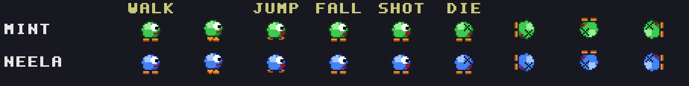
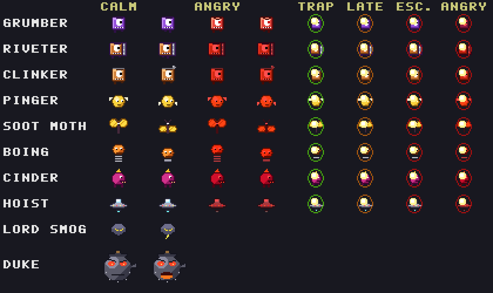

# Blubber Blasen – Story

The story is short and is told in a few places only: an intro after the title screen, the name of each part of the factory, a short scene after each boss, three clues in the secret rooms, and two endings. Everything else is play.

## Setting

**Blasenhausen** is a small town that runs on soap bubbles. They light the streets, carry the post and make the music. All bubbles come from the old **bubble factory** at the edge of town.

One night a greedy steam boiler that calls itself **Duke Grumble** takes over the factory. It wants to make soot instead of bubbles, and it turns the factory workers into its helpers: the monsters of the game. Since then the town has been grey and quiet.

## Heroes

| | Player 1 | Player 2 |
|---|---|---|
| Name | **Mint** | **Neela** |
| Colour | green (mint) | blue (Neela is Hindi for blue) |
| Who | A soap blob from the factory's rinse tank. Curious, jumps first and thinks later. | Mint's girlfriend from the same tank. Careful, notices things. |

Both can blow bubbles, which is why the Duke missed them. Each name is also the hero's colour, so players can tell who is who at a glance. Angry enemies turn red, a colour neither hero uses.

The sprites are the current placeholder art. Player 2 uses the same sprite with the green swapped
for blue, a palette swap as on the SNES.

## The enemies are the factory workers

Every enemy is a worker Duke Grumble has bewitched. A defeated enemy turns back into a worker, and as a thank-you the worker leaves food behind. That is why enemies become food.

Columns, left to right: two calm frames, two angry frames, then the enemy trapped in a bubble as
the bubble ages (fresh, later, about to escape) and, last, trapped while angry. The Grumber has its
own angry frames; the others are tinted red, as the game does. Lord Smog and Duke Grumble have no
angry stage. All of it is placeholder art.

| Type | Name | Job in the factory |
|---|---|---|
| Walker | Grumber | Shovels coal; the Duke's common helpers, named after him |
| Shield | Riveter | Rivets boiler plates and hides behind one |
| Thrower | Clinker | Loads the furnaces and throws lumps of clinker |
| Bouncer | Pinger | A rivet that sprang loose and pings off every wall |
| Flutter | Soot Moth | Lives in the chimneys |
| Hopper | Boing | Repairs the spring presses |
| Spitter | Cinder | Keeps the fires going and spits embers |
| Dropper | Hoist | Moves the loads under the roof and drops them |
| Hurry Up chaser | Lord Smog | The Duke's own breath and his steward: shows up when the players take too long, cannot be defeated |

## The rounds are the parts of the factory

> **Planned, not built yet.** This section describes the structure decided on 2026-11-16 (see
> `GAME-TODO.md`, "Game structure"). The game still uses ten floors of ten rounds (Cellar, Pipe Works,
> Spring Shop, Boiler Room, Conveyor Halls, Drying Lofts, Dye Works, Pump Station, Pressure Tanks,
> The Chimney, and Duke Grumble in round 100), and secret doors in rounds 20, 40 and 60. The names,
> themes and bosses below are a first proposal.

The players climb from the cellar to Duke Grumble at the top through six parts of the factory. Each
part has its own feel, and the Duke has put one of its strongest workers at the end of it as a
boss. The parts get longer the higher the players climb:

| Rounds | Part | Boss round | What makes it feel like one place |
|---|---|---|---|
| 1–5 | The Cellar | 5 | Plain rooms to learn in: trap, pop, bounce |
| 6–15 | Pipe Works | 15 | Strong air in the pipes carries bubbles a long way |
| 16–30 | Conveyor Halls | 30 | Conveyor belts move players, enemies and bubbles |
| 31–50 | Pressure Tanks | 50 | Steam vents blow players and bubbles upwards |
| 51–70 | Dye Works | 70 | Clouds of coloured steam hide parts of the room |
| 71–100 | The Chimney | 100 | Soot rises, the air pulls up, the Duke waits on top |

The name of a part is shown when its first round starts. The look may change inside a part; the
feel stays.

Beating a boss opens the way to the next part, and the players can come back later and start
there (see the game design guide).

## Bosses

Each boss is a worker the Duke has made big and strong, and each is beaten with what its part
of the factory taught. How each fight works is decided in the game design guide.

| Round | Boss (proposal) | Who |
|---|---|---|
| 5 | The Head Stoker | The oldest Grumber, as big as a furnace door. Shovels coal at the players. |
| 15 | The Pipe Foreman | A Riveter who sealed himself inside a pipe junction and only shows his plate. |
| 30 | The Big Spring | A Boing on the factory's largest spring press, riding the belts. |
| 50 | The Tank Cinder | A Cinder that has crawled into a pressure tank and blows steam through every vent. |
| 70 | The Moth Queen | The first Soot Moth, hiding in the dye clouds with her swarm. |
| 100 | Duke Grumble | See below. |

**Duke Grumble** is a huge steam boiler that floats around the top of the factory and spits
soot clouds. Bubbles bounce off its hot iron; only lightning bubbles can hurt it. When it is beaten
it is trapped in a giant bubble, and popping that bubble ends the game.

## Cut scenes between the parts

After each boss a short scene (about 15–20 s, skippable with Start) shows what changed and what
comes next. A first script:

1. **After the Head Stoker (to Pipe Works):** the Head Stoker turns back into an old worker, who
   points up a ladder: "The Duke took the pipes first. Listen how they howl."
2. **After the Pipe Foreman (to Conveyor Halls):** the pipes go quiet and the first clean bubbles
   in a long time drift up the shaft. Above, the belts start rattling: the Duke has heard.
3. **After the Big Spring (to Pressure Tanks):** the belts stop. A window shows Blasenhausen far
   below, grey; one street lamp flickers on.
4. **After the Tank Cinder (to Dye Works):** the tanks hiss empty. Coloured steam pours down the
   stairs, and something with wings moves inside it.
5. **After the Moth Queen (to the Chimney):** the steam clears and the chimney opens above, black
   and endless. Duke Grumble's grumble shakes the walls for the first time.

After Duke Grumble, one of the two endings follows.

## Secret rooms

Each of three secret rooms shows one third of the factory's **off switch code**. Put together, the
three pieces say that the off switch has two levers, which must be pulled at the same time, so it
needs two players.

Proposal for the new structure: one door each in the Conveyor Halls, the Pressure Tanks and the
Dye Works, in the middle of the part (rounds 23, 40 and 60), opening only if nobody has lost a life
since the part began. Whether the warp (today round 50 to round 70) stays, and where, is open.

## Endings

- **One player (sad ending):** Duke Grumble is beaten, but without someone at the second lever the factory only falls silent. The workers stay asleep and Blasenhausen stays grey. A last line tells the player to come back with a friend.
- **Two players (happy ending):** Mint and Neela pull both levers at once. The workers wake up as themselves, the factory starts blowing bubbles again and the town lights up. Credits follow.

## Intro text (shown after the title, skippable)

1. Blasenhausen runs on soap bubbles. They all come from the old bubble factory.
2. One night Duke Grumble took over. Now it makes soot, and its workers have turned into monsters.
3. Only two soap blobs got away: Mint and Neela. Climb the factory, set the workers free and stop Duke Grumble!
